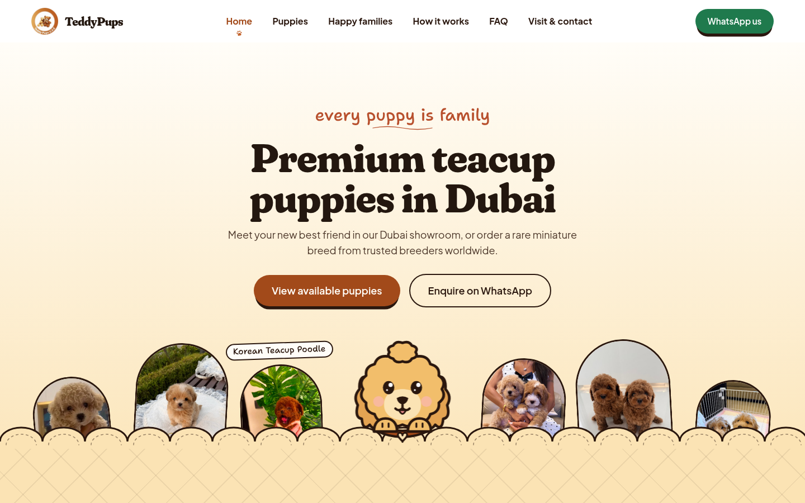
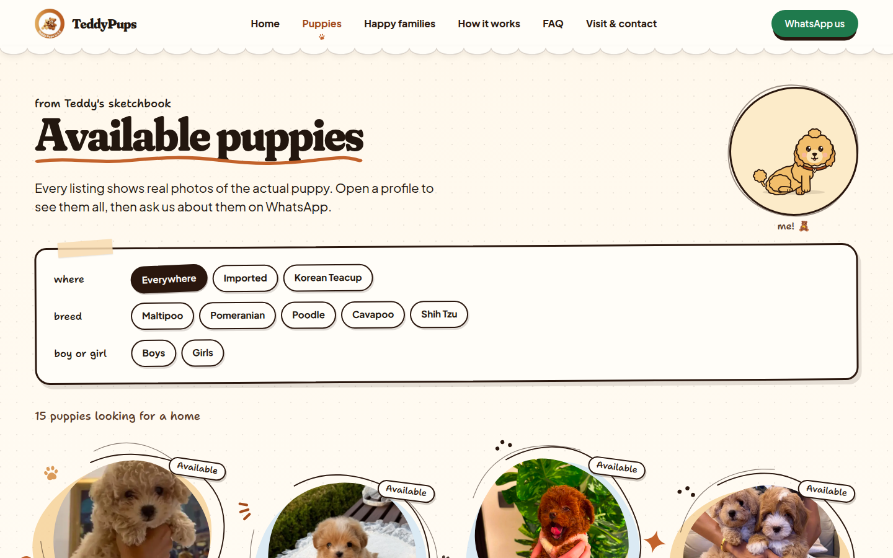
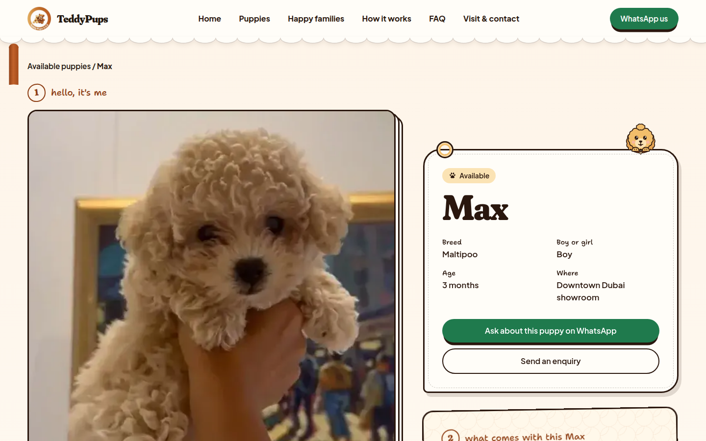
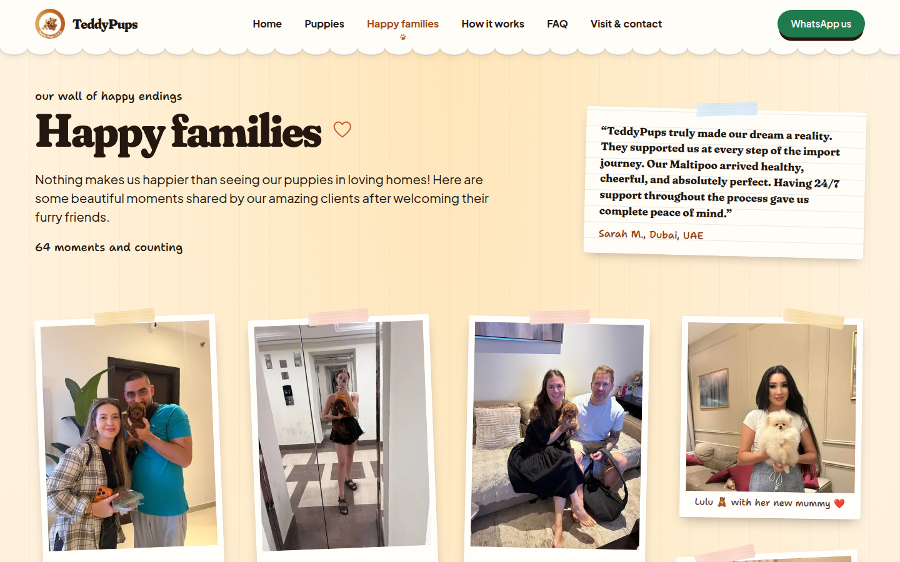
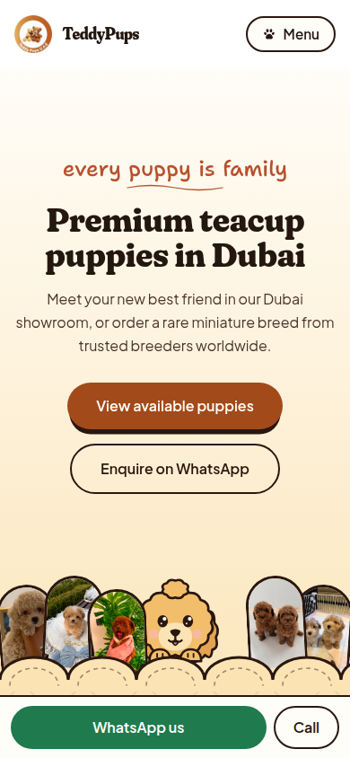

# TeddyPups U.A.E. — Technical Assignment

A complete, pixel-accurate clone of the [TeddyPups reference website](https://puppy.instabizweb.com/), developed for the Blutec AI Technical Round.

**Live Demo:** [https://blutec-ai-technical-assignment.vercel.app/](https://blutec-ai-technical-assignment.vercel.app/)  
**Reference Site:** [https://puppy.instabizweb.com/](https://puppy.instabizweb.com/)

---

## Screenshots

### Desktop Views

| Homepage Hero & Door Cards | Available Puppies Catalog |
| :---: | :---: |
|  |  |

| Single Puppy Detail Page | Happy Families Gallery |
| :---: | :---: |
|  |  |

### Mobile Responsiveness

<p align="center">
  
</p>

---

## Features

- **8 Complete Routes**:
  - `/` — Homepage with animated 3D arched door cards, flight arcs, puppy passport, and Polaroid testimonial shelf.
  - `/puppies` — Sketchbook catalog with instant client-side filtering by collection, breed, and gender.
  - `/puppies/:slug` — Individual puppy storybook pages with reading ribbon progress, photo carousel, and fullscreen lightbox.
  - `/happy-families` — Photo memory board with keyboard-accessible modal viewer.
  - `/how-it-works` — Tabbed guide covering showroom visits and international import processes.
  - `/faq` — Interactive corkboard with pinned notes, live search, and question expansion.
  - `/contact` — Interactive letterform with live typing feedback, postage stamp, and sealing animation.
  - `/gone-home` — Archival boarding pass tickets for puppies in their forever homes.
- **Micro-Interactions & Mascot**:
  - Animated puppy mascot interacting across scenes and sitting on the mobile sticky contact bar.
  - Tactile spring physics, curved scallop dividers, and custom cursor effects.
- **SEO & Accessibility**:
  - Dynamic document title and meta description updates on route change.
  - Valid Schema.org structured data (`PetStore`, `FAQPage`, `BreadcrumbList`).
  - OpenGraph, Twitter Card tags, `sitemap.xml`, and `robots.txt`.

---

## Tech Stack

- **Framework**: [React 19](https://react.dev/) + [TypeScript](https://www.typescriptlang.org/)
- **Bundler & Tooling**: [Vite](https://vitejs.dev/)
- **Styling**: [Tailwind CSS](https://tailwindcss.com/) + Custom OKLab Theme Tokens
- **Animation**: [Framer Motion](https://www.framer.com/motion/)
- **Routing**: [React Router v6](https://reactrouter.com/)
- **Icons**: [Lucide React](https://lucide.dev/)

---

## Getting Started

### Prerequisites

- Node.js (v18 or higher)
- npm or pnpm

### Installation

1. Clone the repository:
   ```bash
   git clone https://github.com/shauryagupta2002/blutec-ai-technical-assignment.git
   cd blutec-ai-technical-assignment
   ```

2. Install dependencies:
   ```bash
   npm install
   ```

3. Run the development server:
   ```bash
   npm run dev
   ```

4. Build for production:
   ```bash
   npm run build
   ```

---

## Deployment

The application is deployed on **Vercel** with automated continuous integration:
- **Live URL**: [https://blutec-ai-technical-assignment.vercel.app/](https://blutec-ai-technical-assignment.vercel.app/)
